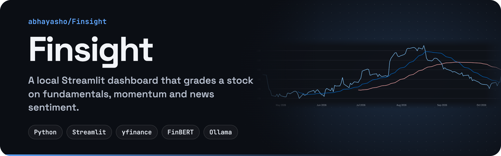
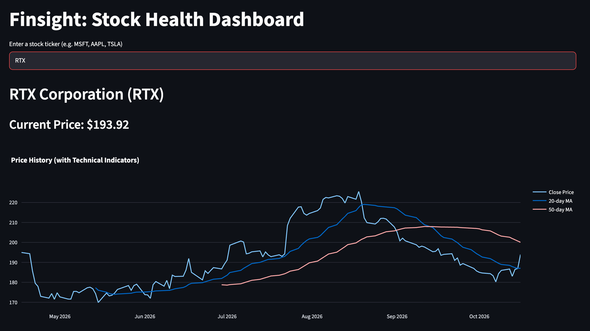
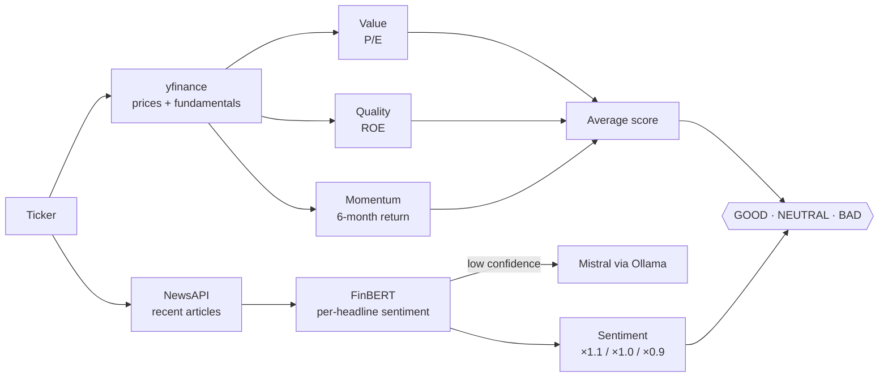

<p align="center">
  
</p>

<p align="center">
  
  
  
  
</p>

**Finsight** is a stock health dashboard you run on your own machine. Type a ticker and it pulls prices and fundamentals, plots moving averages, scores the stock on value, quality and momentum, reads recent news with FinBERT (and a local Mistral model for the unclear headlines), then combines it all into one **GOOD / NEUTRAL / BAD** verdict.

<p align="center">
  
  <br>
  <sub>Looking up RTX: current price and six months of closes with 20- and 50-day moving averages.</sub>
</p>

## What it shows

| Section | Details |
| --- | --- |
| **Price chart** | Six months of closing prices with 20-day and 50-day moving averages (Plotly) |
| **Key metrics** | Market cap, P/E (TTM), EPS (TTM), dividend yield, 52-week high and low, ROE |
| **Valuation vs. industry** | The company's P/E against an industry average P/E |
| **Quant factor scores** | **Value** (P/E bands), **Quality** (ROE bands) and **Momentum** (6-month return), each scored 0, 50 or 100 |
| **News sentiment** | Recent headlines from NewsAPI, each classified with FinBERT. Low-confidence or neutral ones get a second opinion from Mistral |
| **Sentiment trend** | Average daily sentiment over time |
| **News summary** | A Mistral-written summary of the recent coverage |
| **Final verdict** | The average factor score, nudged ±10% by overall sentiment: ≥ 70 is GOOD, ≥ 40 NEUTRAL, otherwise BAD |

Everything runs locally. The language models come from Hugging Face (FinBERT) and Ollama (Mistral), and the only API key you need is a free NewsAPI key.

## Getting started

### 1. Install

```bash
git clone https://github.com/abhayasho/Finsight.git
cd Finsight
pip install -r requirements.txt
pip install torch   # FinBERT runs on PyTorch
```

### 2. Add your NewsAPI key

Get a free key at [newsapi.org](https://newsapi.org), then create `secrets.txt` in the project folder:

```
NEWS_API_KEY=your_key_here
```

`secrets.txt` is already in `.gitignore`.

### 3. Start the local LLM

Install [Ollama](https://ollama.com), then:

```bash
ollama pull mistral
ollama serve
```

### 4. Run the dashboard

```bash
streamlit run app.py
```

Open the URL Streamlit prints (usually http://localhost:8501) and enter a ticker such as `MSFT`, `AAPL` or `RTX`.

## How the verdict works



## Limitations

- The industry comparison uses a small hard-coded table of sector P/E averages, and the sector is currently fixed to Aerospace & Defense. It's accurate for tickers like RTX, but not yet for other industries.
- Factor scores are coarse (0 / 50 / 100 bands), so treat the verdict as a quick read, not investment advice.
- NewsAPI's free tier limits how many articles and requests you get.

## Built with

[Streamlit](https://streamlit.io) · [yfinance](https://github.com/ranaroussi/yfinance) · [Plotly](https://plotly.com/python/) · [Transformers](https://huggingface.co/docs/transformers) ([FinBERT](https://huggingface.co/yiyanghkust/finbert-tone)) · [Ollama](https://ollama.com) (Mistral) · [NewsAPI](https://newsapi.org)

## License

[MIT](LICENSE) © 2025 Abhay Ashok
